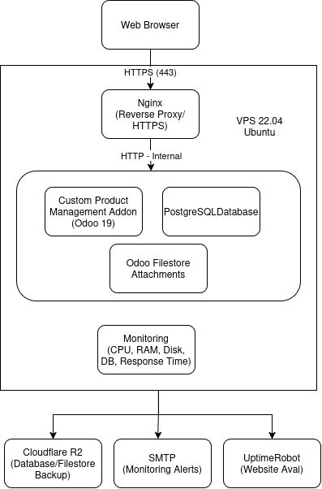

# Overal Architecture Design

| Thuộc tính | Giá trị |
|---|---|
| Dự án | Product Management PV |
| Ứng dụng | Quản lý sản phẩm nội bộ |
| Nguồn đầu vào | `functional_requirements.md`, `non_functional_requirements.md` |
| Phiên bản tài liệu | Draft 1 |
| Ngày lập | 2026-08-06 |

## 1. Nội dung tài liệu

Tài liệu này mô tả kiến trúc tổng quan cả hệ thống Product Management PV ở high-level, định hướng kỹ thuật

